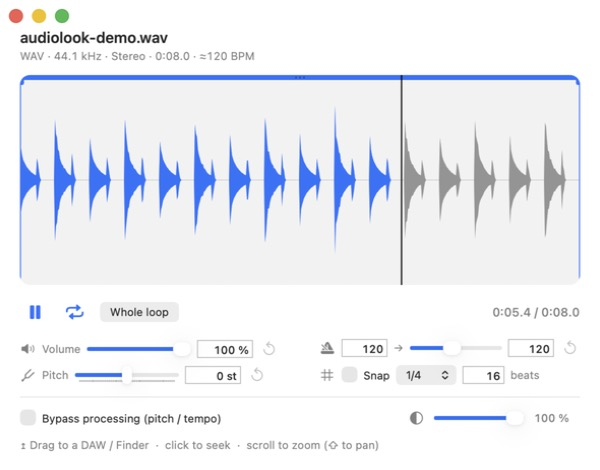
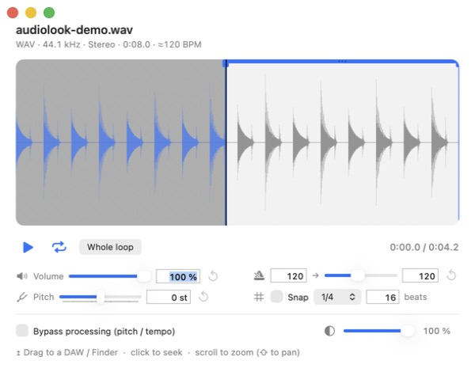

# audiolook

A macOS **audio loop** player in a floating / menu-bar window, with **high-quality**
time-stretch and transposition (Signalsmith Stretch engine, offline rendering).
Made to audition and prepare samples before dragging them into a DAW.

The interface follows the system language (English, or French on a French macOS).
See the [changelog](CHANGELOG.md) for what's new.




### Support the project
Free and open-source 🙂 — if you feel like it, buy me a few tokens:

[](https://paypal.me/lbenh)

## Features

- **Waveform** with playhead; click to seek. **Zoom** with the mouse wheel or a trackpad pinch;
  **pan** with a two-finger horizontal scroll (trackpad) or **Shift + wheel** (mouse).
- **A/B loop** with crossfade (click-free): two handles, or the **bar at the top between
  A and B** to slide the whole region (freely, or snapped to the grid).
- **Tempo (BPM)**: automatic detection + match to a target BPM (pitch unchanged).
  Source BPM is editable, or enter the number of beats.
- **Transposition** −24…+24 semitones (tempo unchanged).
- **Magnetic grid** (1/16, 1/8, 1/4, bar) derived from the BPM.
- **Attack preserved** at the loop start (no fade over the first transient — the kick stays punchy).
- **Volume**, adjustable window **transparency**, values editable from the keyboard.
- **Bypass processing** to compare with the original.
- **Follow the Finder selection**: selecting an audio file opens and plays it automatically;
  a non-audio selection stops playback. Playback also stops when the window is closed.
- **Export**: **drag the waveform** straight into any DAW (or the Finder) — drop it exactly
  where you want it in the arrangement. The exported WAV (24-bit) includes the applied pitch and
  tempo, and, if the A/B loop isn't the whole file, contains only the segment between the markers.
- Settings **kept from one file to the next** (volume / pitch / bypass). The tempo resets to
  each sample's own detected BPM.

## Install (DMG)

Download [`audiolook.dmg`](audiolook.dmg), open it and drag **audiolook** into **Applications**.

The app is **ad-hoc signed** (no paid Apple Developer account), so on **first launch**:
right-click **audiolook › Open › Open** (macOS 13/14), or System Settings › Privacy & Security ›
**“Open Anyway”** (macOS 15). A short “Read me” is included in the DMG.

audiolook lives in the **menu bar** (no Dock icon): select an audio file in the Finder and it
opens on its own.

## Export to a DAW

- **Drag the waveform**: just drag the waveform itself into your DAW's arrangement and drop it
  where you want (the playhead position, for instance) — works with any DAW. A single **click**
  on the waveform still moves the playhead; the A/B handles and the top bar keep their own drags.
- **Processing included**: the exported WAV reflects the current pitch and tempo (unless
  **Bypass** is on, which exports the original).
- **A/B region**: when the A/B loop is *not* the whole file, only the segment between the A and B
  markers is exported. Click **Whole loop** to reset A/B and export the whole file.
- To **save** the file instead of dropping it in a DAW, just drag it into a Finder window or onto
  the Desktop.

## Build (without Xcode)

The **Command Line Tools** are enough:

```bash
./build.sh
```

The script compiles the C++ bridge (Signalsmith) with `clang++`, then the app with `swiftc`,
ad-hoc signs it and installs it to `~/Applications/audiolook.app`.
`DEVELOPER_DIR` is forced to the Command Line Tools (avoids the Xcode license).

To build the DMG: `./makedmg.command` (produces `audiolook.dmg`).

## Architecture

```
Src/
  main.swift                app (menu-bar agent)
  AppDelegate.swift         global shortcut, Finder-selection follow, window
  PlayerViewController.swift UI (waveform, controls, export)
  LoopPlayer.swift          A/B loop playback, fades, re-render
  SampleProcessor.swift     file read + Signalsmith render + WAV export
  BPMDetector.swift         tempo detection (RMS envelope + autocorrelation)
  WaveformView.swift        waveform + A/B handles + magnetic grid
  WaveformAnalyzer.swift    peak/RMS computation
  LogicImporter.swift       temp WAV export for drag-and-drop / render
  Localize.swift            tiny EN/FR localization helper
  StretchBridge.{h,cpp}     C bridge to Signalsmith Stretch
  Bridging.h                Swift/C bridging header
Vendor/                     Signalsmith Stretch + Linear (headers)
```

## Licenses

Third-party code in `Vendor/` (see `LICENSE-THIRD-PARTY.md`):
- [Signalsmith Stretch](https://github.com/Signalsmith-Audio/signalsmith-stretch) — MIT
- [Signalsmith Linear](https://github.com/Signalsmith-Audio/linear) — MIT
